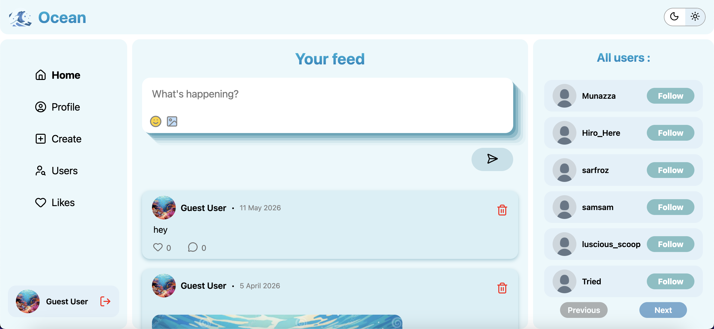
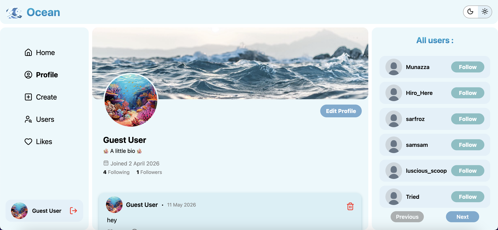
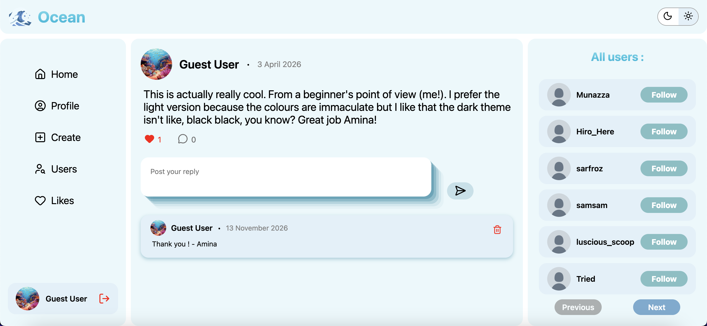
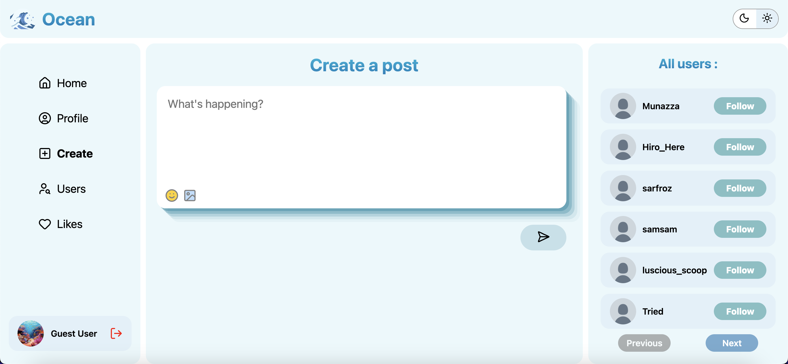

# OCEAN 🌊

**OCEAN** is a full-stack social networking application designed to let users connect, share content, and interact with one another through a personalized social experience.

Users can create posts, engage with other people's content, follow other users, and customize their profiles. OCEAN brings together essential social networking features in a responsive application with authentication and a personalized dashboard.

<p align="center">
  <a href="https://amina-ocean.vercel.app">🌐 Live Demo</a>
</p>

## 📸 Screenshots

<!-- Replace the placeholders with screenshots of your application -->

| Home Feed                               | User Profile                             |
| --------------------------------------- | ---------------------------------------- |
|  |  |

| Post Interactions                                       | Create a Post                                 |
| ------------------------------------------------------- | --------------------------------------------- |
|  |  |

## ✨ Features

- **Authentication** — Secure sign-up and login using Passport.js Local Strategy, bcrypt password hashing, and session-based authentication.
- **Guest Login** — Explore the application using the guest login feature.
- **Social Feed** — Create and view posts shared by users.
- **Post Interactions** — Like and comment on posts.
- **Follow System** — Follow other users and build social connections.
- **User Profiles** — Customize profiles with profile pictures and cover images.
- **Image Uploads** — Upload and manage images using Cloudinary and Multer.
- **Personalized Dashboard** — Access protected user content through an authenticated dashboard.
- **Theme Switching** — Switch between light and dark themes.

## 🛠️ Tech Stack

| Category           | Technologies                      |
| ------------------ | --------------------------------- |
| Frontend Framework | React, Vite                       |
| Frontend Libraries | React Router, Axios, Lucide React |
| Backend            | Node.js, Express.js               |
| Database           | PostgreSQL                        |
| ORM                | Prisma                            |
| Authentication     | Passport.js, Passport Local       |
| Session Management | Express Session                   |
| Password Security  | bcrypt                            |
| Image Storage      | Cloudinary, Multer                |
| Deployment         | Vercel, Render                    |
| Database Hosting   | Neon                              |

## 🗄️ Database Architecture

OCEAN uses PostgreSQL with Prisma ORM to manage its relational data model.

Prisma provides database access and query management, supporting the application's user accounts, social connections, posts, and interactions.

Database schema and migration files are located in `server/prisma`.

## 🚀 Getting Started

### Prerequisites

- Node.js
- PostgreSQL database
- npm

### Installation

1. Clone the repository:

   ```bash
   git clone https://github.com/AminaAssouane/ocean.git
   cd ocean
   ```

2. Install the frontend dependencies:

   ```bash
   cd client
   npm install
   ```

3. Install the backend dependencies:

   ```bash
   cd ../server
   npm install
   ```

4. Create a `.env` file in both the `client` and `server` directories and configure the required environment variables.

   **Client `.env`:**

   ```env
   VITE_API_URL=http://localhost:3000
   ```

   **Server `.env`:**

   ```env
   DATABASE_URL=
   PORT=3000
   SESSION_SECRET=
   CLIENT_URL=http://localhost:5173
   CLOUDINARY_CLOUD_NAME=
   CLOUDINARY_API_KEY=
   CLOUDINARY_API_SECRET=
   ```

5. Generate the Prisma client and apply database migrations from the server directory:

   ```bash
   npx prisma generate
   npx prisma migrate dev
   ```

6. Start the backend server:

   ```bash
   node src/app.js
   ```

7. In a separate terminal, start the frontend development server:

   ```bash
   cd client
   npm run dev
   ```

8. Open [http://localhost:5173](http://localhost:5173) in your browser.

### Environment Variables

**Client**

| Variable       | Description           |
| -------------- | --------------------- |
| `VITE_API_URL` | Backend API base URL. |

**Server**

| Variable                | Description                                          |
| ----------------------- | ---------------------------------------------------- |
| `DATABASE_URL`          | PostgreSQL database connection string.               |
| `PORT`                  | Port used by the Express server. Defaults to `3000`. |
| `SESSION_SECRET`        | Secret used to sign session cookies.                 |
| `CLIENT_URL`            | Frontend URL used for CORS configuration.            |
| `CLOUDINARY_CLOUD_NAME` | Cloudinary cloud name.                               |
| `CLOUDINARY_API_KEY`    | Cloudinary API key.                                  |
| `CLOUDINARY_API_SECRET` | Cloudinary API secret.                               |

**Note:** Never commit your `.env` files or expose your secret values publicly.

## 💡 Motivation

OCEAN was built as a full-stack portfolio project to deepen my experience with modern web development, relational database design, authentication, session management, and cloud-based image storage.

Building OCEAN allowed me to explore the development of a complete social networking application, bringing together frontend and backend development, database management, and deployment.

---

**Built by [Amina Assouane](https://github.com/AminaAssouane)**
